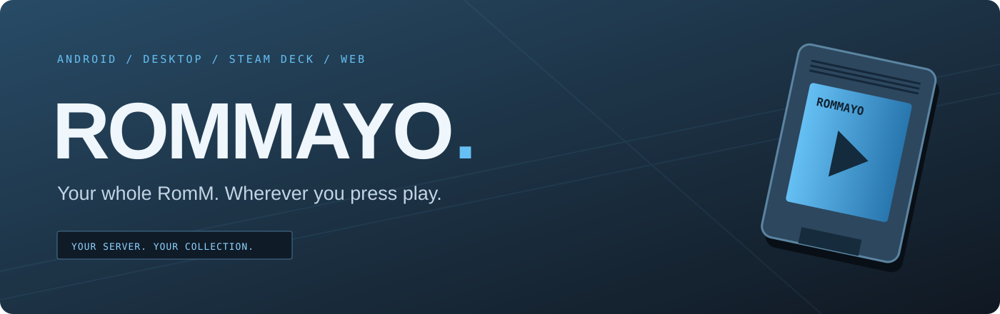
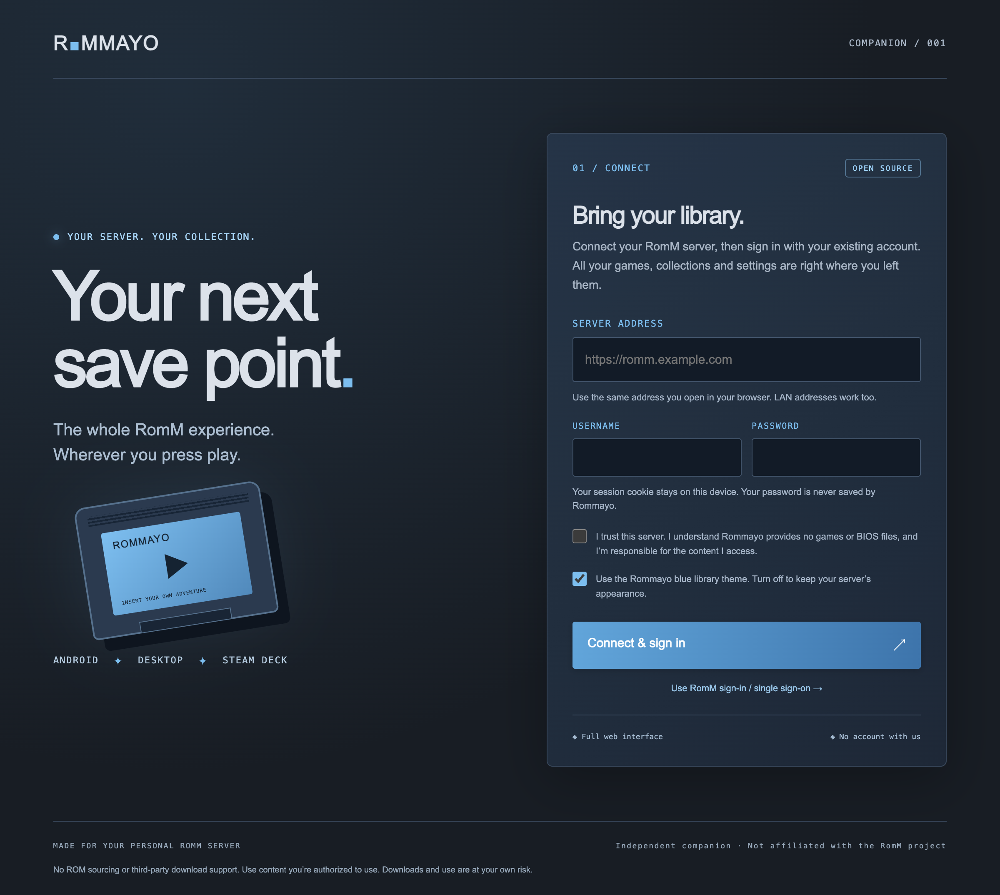

<p align="center"></p>

<p align="center">
  <a href="https://github.com/quentinmayo/Rommayo/releases"></a>
  <a href="LICENSE"></a>
  <a href="https://github.com/rommapp/romm"></a>
</p>

**Your server. Your collection. Your next save point.**

Rommayo brings your self-hosted [RomM](https://romm.app/) library to Android phones and tablets, desktop computers, Steam Deck, and a self-hosted web app. A Steam-inspired blue interface wraps the **actual RomM website**, so browsing, search, recently played, collections, game details, browser players, saves, and server administration stay in RomM's hands.

Enter your **server IP or URL, username, and password**. Rommayo signs into RomM and keeps the session cookie on your device. The wrapper does not save your password, and there is no Rommayo account or central service.

> **Public alpha:** The full RomM interface is available, but that does not mean every emulator and web API has been certified on every device. See the [compatibility and test matrix](docs/compatibility.md).

<p align="center"></p>

## Pick your screen

| Device | Edition | Start here |
| --- | --- | --- |
| Android phone / tablet | Signed APK · Android 10+ | [Download releases](https://github.com/quentinmayo/Rommayo/releases) |
| Steam Deck / Linux x64 | AppImage · fullscreen mode | [Steam Deck guide](docs/steam-deck.md) |
| Windows x64 | Desktop installer | [Download releases](https://github.com/quentinmayo/Rommayo/releases) |
| macOS Apple Silicon | Desktop disk image | [Download releases](https://github.com/quentinmayo/Rommayo/releases) |
| Browser | Self-hosted web companion | [Web / Docker guide](docs/web.md) |

Steam Deck support means a **non-Steam application** you add to your library. Rommayo is not listed on the Steam store, Steam Verified, or affiliated with Valve.

## The whole library comes along

- **Full RomM interface.** Use the same pages and permissions as your website, including features added by your server version.
- **Your existing login.** Native username/password sign-in, or RomM's own sign-in page for SSO.
- **Sessions that stick.** Cookies stay in the OS web engine's app storage. Switch servers without giving a central service your credentials.
- **Blue library theme.** Deep navy surfaces, cyan accents and compact cards. Disable it on the connection screen to retain RomM's own appearance.
- **Native files.** Uploads use your file picker. Desktop supports normal and blob downloads; Android uses Downloads or a save dialog for generated files.
- **Room to play.** Fullscreen browser players, touch input and the web engine's gamepad support. No separate emulator binaries are bundled.
- **Self-hosted web option.** One configured upstream, independent browser sessions, streaming uploads/downloads and WebSocket forwarding.

## Connect in three steps

1. Run your own [RomM server](https://docs.romm.app/latest/getting-started/quick-start-guide/).
2. Install Rommayo and enter the same URL or IP you use in your browser. Include `http://` explicitly for an unencrypted LAN server; addresses without a scheme use HTTPS.
3. Enter your RomM username and password, acknowledge the server notice, and connect. To resume an existing session or use SSO, choose **Use RomM sign-in**.

Your device must be able to reach your server. A private LAN IP needs the same network or a suitable VPN. HTTPS is recommended, especially for gamepad, WebRTC and other browser APIs that require a secure context. Certificate validation stays enabled.

The app's toolbar provides **Back**, **Home**, **Reload**, **Fullscreen**, and **Switch server**. Leaving fullscreen on Android uses the system Back gesture. Desktop shortcuts: `F11` fullscreen, `Esc` exit fullscreen, `Alt+Left` back, and `Ctrl/Cmd+Shift+S` switch server.

## Build it yourself

```sh
git clone https://github.com/quentinmayo/Rommayo.git
cd Rommayo
npm ci
npm start
```

```sh
# Desktop packaging for your current platform
npm run dist

# Android: JDK 21 and Android SDK 36
printf 'sdk.dir=/your/android/sdk\n' > android/local.properties
cd android
./gradlew assembleDebug
```

Release APKs require signing environment variables; see [development and releases](docs/development.md). Debug and release APKs use different signing identities. Uninstall a debug installation before switching to the public release; that clears its local session.

For the web edition:

```sh
ROMMAYO_UPSTREAM=https://romm.example.com npm run start:web
# Open http://127.0.0.1:8787/__rommayo/
```

## No games included

**Rommayo does not provide, host, source, or distribute ROMs, BIOS files, decryption keys, or game content.** We do not support finding games or downloading them from third-party sites. Transfers from your own RomM server are your responsibility. Use only content you are authorized to access; downloads and use are at your own risk.

RomM handles emulation, metadata, server permissions, save behavior and game compatibility. Rommayo is an independent companion, not an official RomM, Steam or emulator project. The blue visual style uses original assets and does not include Valve branding.

## Under the hood

```text
shared/    Original connection UI + optional RomM theme
desktop/   Sandboxed Electron shell; separate cookie session per server origin
android/   Native Android host; origin-restricted shell and separate RomM WebView
web/       Self-hosted, fixed-upstream streaming companion proxy
tests/     Address policy, proxy behavior and desktop integration checks
docs/      Setup, compatibility and release instructions
```

See [security](SECURITY.md), [contributing](CONTRIBUTING.md), and the [MIT license](LICENSE). RomM is a separate [AGPL-3.0 project](https://github.com/rommapp/romm); its source and emulator components are not bundled here.
